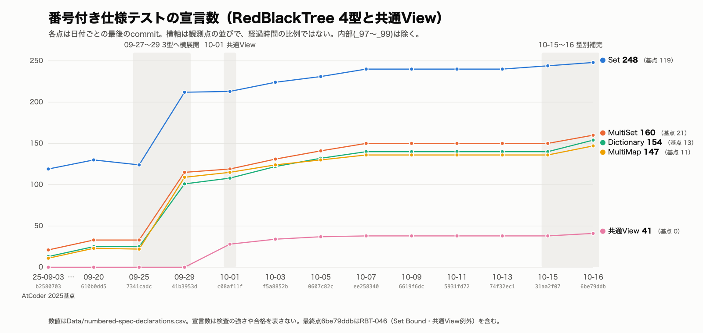

# テスト再建の記録（2026年秋）

2026-10-16 / Claude（姫、Opus 5.5）。事実・件数・commitの正本は[別紙](EVIDENCE.md)に置き、本紙はその証拠から成立する説明の正本とする。

## この記録の位置づけ

[AtCoder 2025からのリファクタリング記録](../RefactoringFromAtCoder2025/README.md)は、人が手で進めた赤黒木本体の構造変更と、それに伴うテストの縮退と再建を扱う。同書は、2026年秋以降にCoding Agentへ頼んだリファクタリングは主にテストコードの再編・再建だった、と書いている。

本紙は、その「テスト側」の記録である。赤黒木本体の構造はすでに人の手で収束していた。その上で、AIが公開挙動の仕様テストを書き、点検し、補ってきた過程を残す。

扱う範囲は、2026-09-20頃から2026-10-16までである。それより前の谷と回復の件数は、上記の記録に任せる。

## 作業主体と分担

テストの再建は、AIが行った。番号付き仕様テストの横展開、Death Test、寿命の検査、レビュー指摘の反映は主にClaude（姫）が書いた。各段階の横断点検と受入はCodexとAstraが行い、commitと判断はユーザーが行った。

この記録の対象には、製品sourceの構造変更は含めない。テストで見つかった不具合を直したsourceの修正は、記録の中で区別して扱う。

## 一枚で見る歩み

図は、RedBlackTreeの公開4型と共通Viewについて、番号付き仕様テスト（`<型>_<番号>_*.swift`、内部と一時のものは除く）の宣言数を並べたものである。横軸は観測点の並びで、時間の長さには比例しない。宣言数は検査の強さや合格を表さない。

形として読めることは三つある。

1. **一つの型の形を、他の型へ写した。** AtCoder 2025の時点で番号付き仕様テストが揃っていたのはSetだけで、他の3型は2ファイルずつだった。2026-09-27〜29に、Setの仕様群の分け方がMultiSet・Dictionary・MultiMapへ写された。各型15〜16ファイルになり、宣言数は数倍になった。
2. **型をまたぐ部品を、独立した仕様にした。** 2026-10-01に、4型が共有するRange ViewとMapped Values Viewが、それぞれの仕様テストを持った。
3. **伸びが止まった後に、もう一段補った。** 10-07から10-13までは、5系列とも数が動かない。この間、テストの仕事はOptionalArray・Permutation・BareArrayの仕様テストとcompiler fixtureへ移っていた。10-15〜16には、レビューで見つかった不足を型ごとに補い、4型とも再び伸びた。

## 基盤を先に作る

仕様テストを書くことと同じくらい、テストを信じられる状態にすることに時間を使った。

- **全体の合否を何で判定するか。** Xcodeの`RunAllTests`が、数百件を実行しないまま「0 failed」を返すことがあった。以後、全体の合否は`swift test`で判定する。
- **寿命を数える。** Debug buildのprocess-global counterで、Node・payload・allocationの生成と解放を数える。各XCTestの後に一致を検査し、必ず0へ戻す。test targetをまたいで汚れないようにするためである。
- **止まり方を区別する。** Death Testは、Swiftのtrapを期待するものと、広い異常終了を許すものを分ける。前者は、DarwinのSIGTRAPとLinuxのSIGILLに完全一致させる。SIGSEGVは、不正なメモリアクセスの疑いとして拒む。
- **他の実装と比べる。** C++の`std::set`・`multiset`・`map`・`multimap`と挙動を比べる専用targetを置いた。
- **型で守る契約は、compilerで確かめる。** `~Copyable`や借用の寿命のように、testのruntimeでは観測できない契約がある。そうした契約は、通る例と拒否される例をcompiler fixtureで固定した。拒否される例は、期待した診断が出たことまで照合する。

## テストが見つけたもの

テストを書いていると、ときどき製品の不具合に当たる。この期間に、製品の修正とテストが同じcommitに入ったものを、8件記録した（[別紙4.](EVIDENCE.md#4-テストと同じcommitで直った製品の不具合)）。

性質で分けると、だいたい次の三種類になる。

- **意味の取り違え。** MultiMapの`index(inserting:)`が、重複を許さない挿入を呼んでいた。
- **所有の数え違い。** Dictionaryで参照型の値を`nil`代入で消すと二重に解放された。Permutationでは、bufferのheaderを二重に破棄していた。どちらも、寿命を数える仕組みがなければ表に出にくい。
- **入口ごとの包み方の違い。** 範囲指定の`erase(_:where:)`だけが、利用者のエラーを返さずに止まっていた。全範囲版やBound範囲版は正しかった。範囲を検査するための`catch`が、利用者のエラーまで捕まえていた。

三つ目は、Setで一つ見つけた形が、4型すべてにあった。型別に同じ形の仕様を持っていたので、残りの3型も同じ形のはずだと読めた。修正は4型同時に入った。

## 往復で補う

最後の段階では、書く役と点検する役を分けて往復した。Astraが静的にレビューして課題を出した。Claudeがtestへ反映し、自分の実行結果を返した。Astraがもう一度、独立に実行して受け入れた。

順番は、初回横断、型別レビュー、型別補完、最終横断、追加補完とした。型別に19件の指摘があり、最終横断で2件が加わった。反映の途中で、上の範囲`erase`の不具合が見つかった。

この往復で、二つのことが決まった。

- 公開結果だけで確かめられるBoundの動作は、4型ともReleaseでも実行する。内部の観測はDebugに残す。
- 重複keyでの`.lessThanOrEqual(k)`がどの値を指すかは、文書の定義どおり規定しない。テストもkeyだけを確かめる。

前者はテストを広げる決定で、後者はテストに契約を足さない決定である。テストは、確かめられることを増やすだけでなく、約束していないことを約束しないようにも働く。

## まだ残っていること

- 宣言数と実行数は、検査の強さを表さない。mutation試験は、一部の項目で一時的に行っただけである。
- Linuxでの全体実行、Swift 6.2、ASanは、この記録の範囲では確かめていない。
- Permutationの借用寿命は、compile-failを再実行できるfixtureになっていない。
- テスト整備の現在地は[`Maintanance/Testing/TESTING.md`](../../Testing/TESTING.md)、fixtureの説明は[`Maintanance/Testing/Fixtures.md`](../../Testing/Fixtures.md)にある。どちらも恒久task `TEST-005`の維持文書である。
