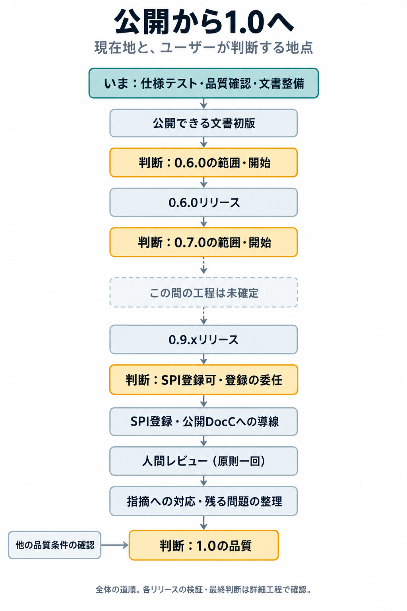

# マイルストーン管理

2026-10-16、Astra。恒久task：OPS-047。

到達点とその成立条件を見渡す入口。作業の状態・担当・依存はTask Registry、到達条件・判断・証拠は下記の個別正本に置く。ここに状態表を複製しない。

## 全体の道順



2026-10-16時点の概観。黄色はユーザーの判断、点線は未確定の工程。各版の検証・最終判断と詳しい依存関係は下記を参照する。

| 到達点 | 条件と判断の正本 | 関連作業 |
| --- | --- | --- |
| 0.6.0の範囲確定とリリース | [0.6.0](Current/RELEASE_0_6_0.md) | RELEASE-078による開始条件照合。実施工程はユーザーのリリース手順 |
| 0.7.0の範囲確定とリリース | [0.7.0](Current/RELEASE_0_7_0.md) | 0.6.0完了と後続差分を材料にする |
| SPI登録と公開導線の成立 | [SPI公開](Current/SPI_PUBLICATION_MILESTONE.md) | QUALITY-005 → DOC-026 → DOC-027 |
| RedBlackTreeのチューニング再探索 | [再探索マイルストーン](Current/RED_BLACK_TREE_TUNING_RESEARCH_DECISION.md) | 旧RBT-035を移行。到達条件・時期・実作業は未確定 |
| Validation計画のレビュー | [文書マイルストーン](Current/DOCUMENTATION_MILESTONES.md#validation計画のレビュー旧doc-032) | 旧DOC-032。公開後の人間レビューとは区別する |
| RedBlackTree文書の本文作成準備 | [文書マイルストーン](Current/DOCUMENTATION_MILESTONES.md#redblacktree文書の本文作成準備旧rbt-014) | 旧RBT-014。現行API・test・設計との照合 |

## 依存関係の見取り図

2026-10-16時点の上記正本・Registry・[文書Validation計画](Current/DOCUMENTATION_VALIDATION_PLAN_DRAFT.md)から、到達点の前後関係を抜き出した図。矢印は前提または判断材料の流れであり、作業開始の自動許可や達成済みの表示ではない。合流点はすべての入力が必要。並行して準備できる仕事まで直列にはしない。

### 0.6.0から0.7.0へ

```text
品質課題・証拠の棚卸し (QUALITY-004)
  |
  v
現行提供区分と0.6.0開始条件の照合 (RELEASE-078)
  |
  v
開始条件の確認 <--- 公開対象の利用者文書が公開可能な初版として揃う
  |
  v
[ユーザー判断] 0.6.0の範囲確定・開始
  |
  v
リリース工程 / 版固有の文書公開要件 / 必要な検証
  |
  v
[ユーザー判断] 最終リリース判断
  |
  v
0.6.0リリース完了 + 含めた範囲・後続へ残した範囲の記録
  |
  v
0.7.0の判断材料 <--- 0.6.0以後の差分・残課題・品質と文書の状態
  |
  v
[ユーザー判断] 0.7.0の範囲確定・開始
  |
  v
具体化したリリース工程・検証・最終判断 --> 0.7.0リリース
```

0.6.0の旧名称を含む対象一覧はRELEASE-078で現行提供区分と照合する。図から対象範囲を追加確定しない。0.7.0から0.9.xまでの工程は未確定なので、間を架空の工程でつながない。

### SPI公開から1.0品質判断へ

```text
0.9.xリリース済み ---------------------+
対象版のSPI登録可判断 (QUALITY-005) ---+--> SPI登録 (DOC-026)
登録実行の明示委任 -------------------+      |
                                             v
                                 package page / 互換性表示 / DocC確認
                                             |
                                             v
                                 README・Pagesへの導線 (DOC-027)
                                             |
AIによる文書の事前確認・修正・再確認 ---------+
                                             v
                                 公開文書の人間レビュー（原則一回）
                                             |
                                             v
                                 必要な修正・再確認・未解決事項の整理
                                             |
                                             v
                                 1.0品質判断への入力
```

人間レビューはSPI公開後、1.0品質判断までの間に置く。計画自体のレビューは別の到達点であり、人間レビューの実施や合格の代わりにはならない。

```text
Comparable採否 (RBT-011) --> Index契約完了 (RBT-001) --+
runtime-check採否 (RBT-009) --------------------------+
品質アセスメント (RBT-034) --------------------------+
Linux品質保証CI (QUALITY-002) -----------------------+
Apple platforms 27の構成確認 (QUALITY-003) -----------+--> 1.0品質判断
SPI登録・公開導線 (DOC-026 / DOC-027) ----------------+    (QUALITY-001)
公開文書の人間レビュー結果・修正後確認 ---------------+
```

これは現在明記された合流条件の概観であり、1.0の全要件一覧ではない。品質調査は独立部分を並行できる。各結果の成立範囲と残余リスクをそろえて判断し、taskの完了数だけで合格にはしない。

### まだ一本の工程に結ばない到達点

```text
Validation計画のレビュー --> 計画への指摘または修正不要の記録
                              （公開後の人間レビューとは別）

赤黒木の現行API・test・設計とworkflow / outlineの照合
  +--> 文書本文の作成準備
  +--> 関連APIの照合結果 --> Mapped Values View契約検討 (RBT-026)

赤黒木チューニング再探索
  [到達条件・時期・対象範囲は未確定。特定版の必須前提には結ばない]
```

RBT-026に必要なのは関連APIの照合結果であり、文書準備マイルストーン全体の完了を追加のゲートにはしない。

## 維持方法

依頼・判断・成果で到達条件が変わったときに、該当正本と関連taskの接続を更新する。人間の判断は一回の記録を参照し、正本とRegistryで同じ判断を二重に求めない。候補採用と最終リリース判断など、意味の異なる判断は混同しない。

マイルストーンへ到達しても恒久taskはDONEにしない。個別の到達証拠・判断日・残す範囲を個別正本へ残す。条件が整っただけで公開・リリース開始・別taskの凍結解除を代行しない。実作業は必要な単位でRegistryへ置き、マイルストーンごとに重複した凍結taskを作らない。

[整理前の記録](Archived/MILESTONE_REORGANIZATION_2026-10-16.md)。RELEASE-007・079は完了ではなくEXCLUDED。版別の判断を削除した意味ではない。
