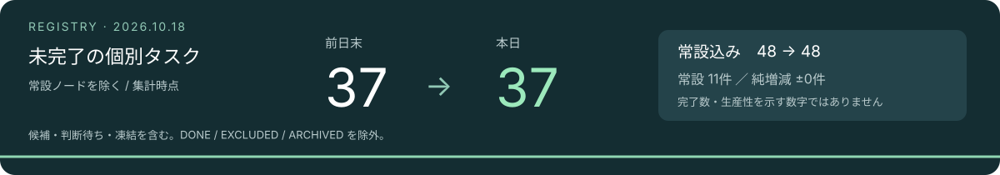

# 進捗報告

<!-- ユーザー指定：横長のタスク数画像は、開いてすぐ見えるよう常にタイトル直下に置く。現在地の説明・集計基準などを画像より前へ追加しない。 -->

## TL;DR（人間向け）

ここは進捗の報告集です。図や件数は記載時点のスナップショットで、工程や現在状態の正本ではありません。

現在地はHEAD、到達条件はMilestonesの各カード、仕事の状態はTask Registryを見ます。公開文書の人間レビューの条件はMS-HUMAN側で確認します。

<!-- OPS-133: 2026-10-19 / Astra。本文を読む入口。決定・状態の正本を置き換えない。本文の結論や境界を変えたときに一緒に見直す。 -->

本書は報告専用。以下の数値は記載時点のスナップショットであり、現在の状態や工程の定義ではない。恒久task：OPS-047。

現在地は[HEAD](Milestones/HEAD.md)、到達条件・判断は[Milestones](Milestones/README.md)、タスクの状態・依存と接続は[Task Registry](ProgressV2/TASK_REGISTRY_V2.md)を参照する。本書にはそれらの定義や管理表を重複して置かない。

## 2026-10-18夕方の報告：受渡しと作業の見える化

参照commit：`3cc115f6`（この報告の更新前）。現在地のHEADは0.6.0のまま。製品のリリースやゲート通過を認定する更新ではない。冒頭の画像・件数は午前10:15の集計を保持しており、夕方の件数として読まない。今回は数の再集計をしていない。

- 姫の連続待機中に、固定した依頼票とactivity通知を使い、設計・実装・限定補修・返却を受け渡した。閉じた会話の自動起動を確認したものではなく、待機継続中の連携である。
- 最近の作業レーンへ承認詳細をまとめた。正式なRegistry状態、活動の工程、コミット承認を区別し、承認待ち・承認済み・処理中を信号と件数で表示するようにした。
- 活動の履歴に担当名と検討中の表示を追加。ユーザーが会話で問い合わせなくても、誰がどこまで進めたかを確認しやすくした。
- Chromium・WebKitのheadless起動、クリック・入力・フォーカスをAstraと姫が確認した。Astraは権限付き実行、姫は当時追加権限なしで成功。これは試験環境の利用確認であり、Studio本体の実ブラウザ検証完了ではない。
- [連携の往復振り返り](Current/ASTRA_CLAUDE_COLLABORATION_RETROSPECTIVE.md)を行い、双方の評価・感想を記入した。通知そのものより固定した依頼範囲・開始条件・停止点が有効だったと整理。新制度を増やさず、Astraの任意な依頼表現や進行停止、承認カードの載せ忘れを運用上の改善点とした。
- 全件承認が一時押せないという報告は、その後ユーザーから押せたと連絡があった。原因未確定。未承認追加の模擬試験では有効化できたため、再発条件を確認せず推測で修正してはいない。

### Studioへの統合案（未実装）

ユーザーの「スタジオに統合したい」を受けた案。本書を報告本文の正本として維持し、Studioの「進捗報告」タブからMarkdownと画像を表示する。別の報告データを複製しない。報告の参照commit・集計時点と、Studioの現在のtask状態は区別する。タスク数の自動集計は別途検討し、報告表示だけに必須としない。実装はまだ依頼していない。

## 2026-10-18の報告：表示の整合と判断の再利用

集計時点：2026-10-18 10:15 JST。参照commitは`4a429669`。HEADの記録は0.6.0。これは現在地の報告であり、リリースやゲートの通過認定ではない。

- Studioの配置要求を恒久側へ整理し、辺のある一般タスクは見取り図、辺のないものは独立欄、恒久木は別扱いとした。表示の重複を修正し、配置試験で確認した。
- 「接続を見る」は、選択カードを中心に左右のカードと実際の接続を示す局所図へ改めた。選択の同期も修正した。
- 単独の後続は右上へ送り出す意図を維持し、複数スタックは下へ配置。上下の水平位置を揃え、必要な区間だけマイルストーン間隔を広げる修正を受け入れた（`b2f9e8e4`）。
- 受入済み版を固定して姫の判断キャッシュ更新を依頼し、記録を受け入れた（`67ac2459`）。任意の感想から既決判断の再利用例と更新時の迷いを拾った。独立したインタビュー制度は増やさず、調整役の運用で扱う。
- 評価・感想と調整役振り返りを記録した（`4a429669`）。今日は表示のバリエーションを残すため、圧縮・掃除は実施しない。

配置の確認はソースと試験によるもの。実画面の独立検証や全レイアウトの保証ではない。複数起点の配置優先、上下選択、版未割当群の版別表示、最終版START→END非表示は今回の修正・受入範囲に含めていない。

### 今回の集計基準

前日末は2026-10-18 00:00 JSTより前の最後のcommit `013b4785`、本日は`4a429669`のRegistry。両時点のRulesに記載された常設nodeを除いて個別タスクを数えた。未完了の状態区分は前回と同じ。

| 指標 | 前日末 | 本日集計時点 |
| --- | ---: | ---: |
| 未完了（常設込み） | 48 | 48 |
| 常設 | 11 | 11 |
| 個別の未完了 | 37 | 37 |
| 凍結（未完了の内数） | 2 | 2 |

本日の未完了内訳はACTIVE 24、PROPOSED 11、USER_ONLY 8、WAITING_EXTERNAL 2、FROZEN 2、WAITING_USER 1。現行表のDONEは31件（前日末13件）。これは表に残る件数であり、当日の完了数とは同一視しない。未完了の純増減ゼロも作業量や生産性を示さない。画像と数値は自動更新ではない。

前回画像：[2026-10-17](Images/task-snapshot-2026-10-17.svg)。

## 2026-10-17の報告：管理の見える化と試行の整理

集計時点：2026-10-17 17:08 JST。HEADの記録は0.5.4。これは現在地の報告であり、リリースやゲートの通過認定ではない。

- StudioのJSON受渡しで、完了成果のENDへの接続と、独立タスクの仮配置を反映した。仮配置は完了必須条件や着手許可にはしない。
- OPS-066の正本冒頭要約を4件で受け入れた。成功条件・確認範囲の表現も照合して補正した。
- Studioにローカル更新サーバーを追加。生成HTML・JSONはGit管理外のキャッシュへ移し、追跡側はテンプレートと生成コードに分離した。
- 判断文書の整理を方針OPS-058と作業候補OPS-068に分けた。START導入OPS-069、仮契約概念の導入検討OPS-070を登録した。後続作業・制度導入が完了した意味ではない。
- 探索の打ち切りをCOMMONSへ記録。試作を答え候補として扱う認識と、変更の狙い・観察できた効果・未確認をノウハウ文書へ残した。

### 今回の集計基準

前日末は2026-10-17 00:00 JSTより前の最後のcommit `4532e9df`、本日は上記時刻のRegistry作業ツリー。未完了はACTIVE / WAITING_USER / WAITING_EXTERNAL / PROPOSED / FROZEN / USER_ONLY。DONE / EXCLUDED / ARCHIVEDを除く。各時点のRulesに定義された常設nodeを除いて個別タスク数を数えた。

| 指標 | 前日末 | 本日集計時点 |
| --- | ---: | ---: |
| 未完了（常設込み） | 44 | 46 |
| 常設 | 10 | 10 |
| 個別の未完了 | 34 | 36 |
| 凍結（未完了の内数） | 2 | 2 |

本日の未完了内訳はACTIVE 23、PROPOSED 12、USER_ONLY 6、WAITING_EXTERNAL 2、FROZEN 2、WAITING_USER 1。現行表のDONEは8件。前日からの差は新規登録・受入・再分類等の純増減であり、完了件数や生産性として読まない。画像と数値は自動更新ではない。

過去の比較画像は[2026-10-16の画像](Images/task-snapshot-2026-10-16-quality-round.png)を保持する。

## 2026-10-16の報告：品質資料整理とタスク圧縮

品質確認資料と棚卸しを[0.6.0-1](Quality/0.6.0-1/)へ保存した。保存先の版名は当時の記録であり、現行のリリース予定を示さない。

この圧縮で完了5件・除外1件を履歴へ移した。集計時点の未完了は31件、常設8件を除く個別作業は23件。下記の集計基準に基づく。原文は[圧縮記録](Archived/TASK_REGISTRY_ARCHIVED_2026-10-16_QUALITY_ROUND.md)を参照する。

## 過去のタスク数スナップショット（2026-10-16）

<!-- ユーザー方針：このタスク数画像のデザインは更新の都度、自由に変えてよい。今回の配色・配置・書体を固定テンプレートにしない。横長で場所を取りすぎず、数値と比較条件が読み取れる形にする。 -->

集計基準（2026-10-16・品質資料整理後の圧縮時点）

前日末は10月16日0時より前の最後のcommit `31aa2f07`、本日は`4709ec3b`後の圧縮済みTask Registry作業ツリーを比較。日付境界はJST。本日終了時点ではなく、上記の圧縮時点を記録した画像であり、自動更新ではない。

- 未完了：ACTIVE / WAITING_USER / WAITING_EXTERNAL / PROPOSED / FROZEN / USER_ONLY。DONE / EXCLUDED / ARCHIVEDは含めない。
- 前日41件、本日31件。このうち常設nodeを除いた個別作業は39件と23件。
- 常設node：前日はGRAPH-001・HIST-001の2件。本日はこれにDOC-030・OPS-043・TEST-005・OPS-044・OPS-046・OPS-047を加えた8件。
- 凍結は25件から1件。解除・再分類・整理を含み、24件の実作業完了を示す数字ではない。
- 個別作業の差16件は新規追加と完了・除外・統合等の純増減。完了数や生産性として読まない。既にDONEだった行のアーカイブ移動は両時点とも未完了数に含まれない。

集計はRegistryの固定ID・状態の行を抽出して行った。今回の未完了数は前回画像と同じで、圧縮により完了5件・除外1件の原文を履歴へ移した。画像は内蔵画像生成で更新し、数値と文言を照合した。横長で、前日末との比較と今回の圧縮を分けて示す。

