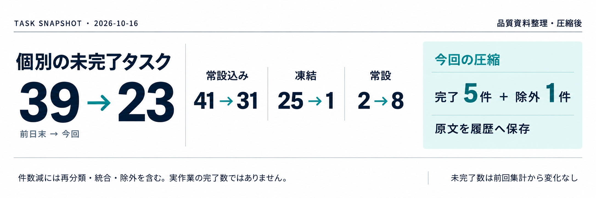
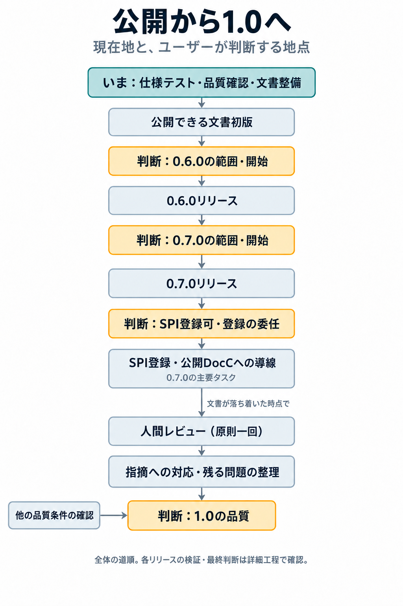

# マイルストーン管理



<!-- ユーザー指定：横長のタスク数画像は、開いてすぐ見えるよう常にタイトル直下に置く。現在地の説明・集計基準などを画像より前へ追加しない。 -->

2026-10-16、Astra。恒久task：OPS-047。

本書は人間用の見通しの入口。AIが過去を読み直さず続ける作業記憶は[現在のAI用ゲート](Cache/Astra/AI_GATE.md)へ分ける。AI用との逐語同期は求めない。[対の維持規則](ProgressV2/TASK_RULES_V2.md#ゲートの人間用資料とai用キャッシュ)に従い、既存ゲートは作業対象になったときに整える。

到達点とその成立条件を見渡す入口。作業の状態・担当・依存はTask Registry、到達条件・判断・証拠は下記の個別正本に置く。ここに状態表を複製しない。

## 現在位置 — 0.5.4のタグ待ち（2026-10-16更新）

今回の0.6.0予定分を0.5.4へ振替。mainへのマージ済み、タグ未作成・未公開。[0.5.4ゲート](Milestones/Archived/RELEASE_0_5_4.md)を現在の入口とし、それ以前は必要な証拠の参照時だけ遡る。立て直しは0.5.4完了後。将来の0.6.0範囲は未定。

以下の旧現在地・図・版別表は準備時の記録であり、今回の版と現在位置は上記を優先する。

## 現在地（2026-10-16・品質資料整理とタスク圧縮後）

0.6.0の重点は、引き続き公開できるドキュメント初版の整備。今回までの品質確認資料と棚卸しは、ユーザー指定の[0.6.0-1](Quality/0.6.0-1/)へ保存した。[判断の記録](Milestones/Archived/RELEASE_0_6_0.md#品質資料の保存に関するユーザー判断-2026-10-16)を参照する。保存は品質合格や0.6.0リリース開始の判断ではない。

次回用の`Quality/Current/`は空（配置保持用の`.gitkeep`のみ）。今後は準備資料・サルベージ資料から、実施中の証拠、評価結果・残課題までを一周分として蓄積する。[品質資料の運用](Quality/README.md#currentで一周分を育てる)に従い、次回の棚卸しは新しく作る。

継続更新を取りやめた旧棚卸しQUALITY-004は除外・履歴化済みで、RELEASE-078の前提にはしない。RELEASE-078は候補状態のまま。着手時点の文書・提供区分・品質課題と証拠を照合して、必要な仕事と判断材料を整理する。

今回の圧縮では完了5件・除外1件を履歴へ移した。未完了は31件、常設8件を除く個別作業は23件で、下の画像と同数。未完了の状態・依存は変更していない。最新状態は[Task Registry](ProgressV2/TASK_REGISTRY_V2.md)、移した原文は[圧縮記録](Archived/TASK_REGISTRY_ARCHIVED_2026-10-16_QUALITY_ROUND.md)を参照する。

## タスク数のスナップショット

<!-- ユーザー方針：このタスク数画像のデザインは更新の都度、自由に変えてよい。今回の配色・配置・書体を固定テンプレートにしない。横長で場所を取りすぎず、数値と比較条件が読み取れる形にする。 -->

<details>
<summary>集計基準（2026-10-16・品質資料整理後の圧縮時点）</summary>

前日末は10月16日0時より前の最後のcommit `31aa2f07`、本日は`4709ec3b`後の圧縮済みTask Registry作業ツリーを比較。日付境界はJST。本日終了時点ではなく、上記の圧縮時点を記録した画像であり、自動更新ではない。

- 未完了：ACTIVE / WAITING_USER / WAITING_EXTERNAL / PROPOSED / FROZEN / USER_ONLY。DONE / EXCLUDED / ARCHIVEDは含めない。
- 前日41件、本日31件。このうち常設nodeを除いた個別作業は39件と23件。
- 常設node：前日はGRAPH-001・HIST-001の2件。本日はこれにDOC-030・OPS-043・TEST-005・OPS-044・OPS-046・OPS-047を加えた8件。
- 凍結は25件から1件。解除・再分類・整理を含み、24件の実作業完了を示す数字ではない。
- 個別作業の差16件は新規追加と完了・除外・統合等の純増減。完了数や生産性として読まない。既にDONEだった行のアーカイブ移動は両時点とも未完了数に含まれない。

集計はRegistryの固定ID・状態の行を抽出して行った。今回の未完了数は前回画像と同じで、圧縮により完了5件・除外1件の原文を履歴へ移した。画像は内蔵画像生成で更新し、数値と文言を照合した。横長で、前日末との比較と今回の圧縮を分けて示す。

</details>

## 版ごとの重点

2026-10-16、ユーザー決定。既存taskを次のように配置する。版ごとのゲート条件（0.6.0・0.7.0・0.8.0の行）は2026-10-17に各ゲートへ移した：[旧0.6.0（今回の0.5.4）](Milestones/Archived/GATE_0_5_4.md) ／ [0.7.0](Milestones/0.6.0/GATE_0_7_0.md) ／ [0.8.0](Milestones/0.7.0/GATE_0_8_0.md)。

| 段階 | 重点 | 接続する既存作業 |
| --- | --- | --- |
| 0.7.0 release後 | SPI登録・公開導線整備 | QUALITY-005 → DOC-026 → DOC-027 |
| 各0.x.0 | 変更点・残課題に応じて品質を改善 | 既存の仕様テスト・品質評価を使い、差分と不足を確認して証拠を次版へ渡す。対象版の必要な検証・最終判断は維持する |

→ [0.7.0のゲート](Milestones/0.6.0/GATE_0_7_0.md)へ移した。

## 全体の道順

画像はSPI前倒し時点の旧スナップショットです。現在の工程準備の0.7.0配置・各版の品質改善・棚卸しの扱いは上表と下の依存関係を参照してください（画像は未更新）。



2026-10-16時点の概観。黄色はユーザーの判断。0.7.0の主要タスクとしてSPI登録・公開導線整備を行う。各版の検証・最終判断と詳しい依存関係は下記を参照する。

| 到達点 | 条件と判断の正本 | 関連作業 |
| --- | --- | --- |
| 0.6.0の範囲確定とリリース | [旧0.6.0（今回の0.5.4）のゲート](Milestones/Archived/GATE_0_5_4.md) | RELEASE-078による開始条件照合。実施工程はユーザーのリリース手順 |
| 0.6.0完了後の互換調査再開判断 | [互換計画](Current/AtCoder2025CompatibilityPlan.md) | PERM-079。リリース完了を確認後、ユーザーが調査再開可否を判断。自動開始・merge許可にはせず、0.6.0の前提にも置かない |
| 0.7.0の範囲確定とリリース | [0.7.0のゲート](Milestones/0.6.0/GATE_0_7_0.md) | 0.6.0完了と後続差分を材料にする。主要タスクは工程準備・公開運用整備とrelease後のSPI登録・公開導線整備 |
| SPI登録と公開導線の成立 | [SPI公開](Milestones/Archived/SPI_PUBLICATION_MILESTONE.md) | QUALITY-005 → DOC-026 → DOC-027 |
| RedBlackTreeのチューニング再探索 | [再探索マイルストーン](Current/RED_BLACK_TREE_TUNING_RESEARCH_DECISION.md) | 旧RBT-035を移行。到達条件・時期・実作業は未確定 |
| 0.7.0リリース前：Validation計画のレビュー | [10_VALIDATION_REVIEW](Milestones/0.6.0/10_VALIDATION_REVIEW.md) | 旧DOC-032。0.7.0ゲート、未通過。0.6.0の前提にせず、SPI登録後の人間レビュー実施とは区別する |
| RedBlackTree文書の本文作成完了 | [10_RBT_DOCUMENTS](Milestones/0.5.4/10_RBT_DOCUMENTS.md) | 旧RBT-014。現行API・test・設計との照合 |

## 依存関係の見取り図

2026-10-16時点の上記正本・Registry・[文書Validation計画](UserDocuments/DOCUMENTATION_VALIDATION_PLAN_DRAFT.md)から、到達点の前後関係を抜き出した図。矢印は前提または判断材料の流れであり、作業開始の自動許可や達成済みの表示ではない。合流点はすべての入力が必要。並行して準備できる仕事まで直列にはしない。

### 0.6.0から0.7.0へ

```text
現行の文書・提供区分・品質課題・証拠
  |  前回の棚卸しは参考資料として参照
  v
現行提供区分と0.6.0開始条件の照合 (RELEASE-078)
  |
  v
開始条件の確認 <--- 公開対象の利用者文書が公開可能な初版として揃う
  |
  v
[ユーザー判断] 0.6.0の範囲確定・開始
  |
  v
現行手順によるリリース / 文書初版 / 対象版の品質確認
  |
  v
[ユーザー判断] 最終リリース判断
  |
  v
0.6.0リリース完了 + 含めた範囲・後続へ残した範囲の記録
  |
  v
0.7.0の判断材料 <--- 0.6.0以後の差分・残課題・品質と文書の状態
  |
  v
[ユーザー判断] 0.7.0の範囲確定・開始
  |
  v
工程準備・公開運用整備 / 検証・最終判断 --> 0.7.0リリース
```

→ 0.7.0の条件に関する注記は[0.7.0のゲート](Milestones/0.6.0/GATE_0_7_0.md)へ移した。

### SPI公開から1.0品質判断へ

```text
0.7.0リリース済み
          |
          v
対象版のSPI登録可判断 (QUALITY-005) ---+--> SPI登録 (DOC-026)
登録実行の明示委任 -------------------+      |
                                             v
                                 package page / 互換性表示 / DocC確認
                                             |
                                             v
                                 README・Pagesへの導線 (DOC-027)
                                             |
AIによる文書の事前確認・修正・再確認 ---------+
                                             v
                                 公開文書の人間レビュー（原則一回）
                                             |
                                             v
                                 必要な修正・再確認・未解決事項の整理
                                             |
                                             v
                                 1.0品質判断への入力
```

人間レビューはSPI公開後、文書が落ち着いてから1.0品質判断までの間に置く。登録直後に実施する必要はない。計画自体のレビューは別の到達点であり、人間レビューの実施や合格の代わりにはならない。

```text
Comparable採否 (RBT-011) --> Index契約完了 (RBT-001) --+
runtime-check採否 (RBT-009) --------------------------+
品質アセスメント (RBT-034) --------------------------+
Linux品質保証CI (QUALITY-002) -----------------------+
Apple platforms 27の構成確認 (QUALITY-003) -----------+--> 1.0品質判断
                                                    |    (QUALITY-001)
公開文書の人間レビュー結果・修正後確認 ---------------+
```

これは現在明記された合流条件の概観であり、1.0の全要件一覧ではない。品質調査は独立部分を並行できる。各結果の成立範囲と残余リスクをそろえて判断し、taskの完了数だけで合格にはしない。

### まだ一本の工程に結ばない到達点

```text
Validation計画のレビュー --> 計画への指摘または修正不要の記録
                              （公開後の人間レビューとは別）

赤黒木の現行API・test・設計とworkflow / outlineの照合
  +--> 文書本文の作成準備
  +--> 関連APIの照合結果 --> Mapped Values View契約検討 (RBT-026)

赤黒木チューニング再探索
  [到達条件・時期・対象範囲は未確定。特定版の必須前提には結ばない]
```

RBT-026に必要なのは関連APIの照合結果であり、文書準備マイルストーン全体の完了を追加のゲートにはしない。

## 維持方法

依頼・判断・成果で到達条件が変わったときに、該当正本と関連taskの接続を更新する。人間の判断は一回の記録を参照し、正本とRegistryで同じ判断を二重に求めない。候補採用と最終リリース判断など、意味の異なる判断は混同しない。

マイルストーンへ到達しても恒久taskはDONEにしない。個別の到達証拠・判断日・残す範囲を個別正本へ残す。条件が整っただけで公開・リリース開始・別taskの凍結解除を代行しない。実作業は必要な単位でRegistryへ置き、マイルストーンごとに重複した凍結taskを作らない。

[整理前の記録](Archived/MILESTONE_REORGANIZATION_2026-10-16.md)。RELEASE-007・079は完了ではなくEXCLUDED。版別の判断を削除した意味ではない。

## 文書ゲートの作業接続（2026-10-16）

→ [旧0.6.0（今回の0.5.4）のゲート](Milestones/Archived/GATE_0_5_4.md)へ移した。

## 0.8.0の追加（2026-10-16ユーザー決定）

→ [0.8.0のゲート](Milestones/0.7.0/GATE_0_8_0.md)へ移した。

0.6.0の対：[人間用ゲート](Milestones/Archived/RELEASE_0_6_0.md) ／ [AI用キャッシュ](Cache/Astra/RELEASE_0_6_0.md)。

## 候補CI・性能比較の立て直し（2026-10-16追加）

[立て直しゲート・協議・プラン](Current/RELEASE_CI_RECOVERY.md)を独立した到達点として管理する。協議 → プラン → 範囲を確定した実行・検証 → 完了ゲートの順。0.6.0後へ後送し、対象版は未定。0.6.0の追加前提にはしない。
