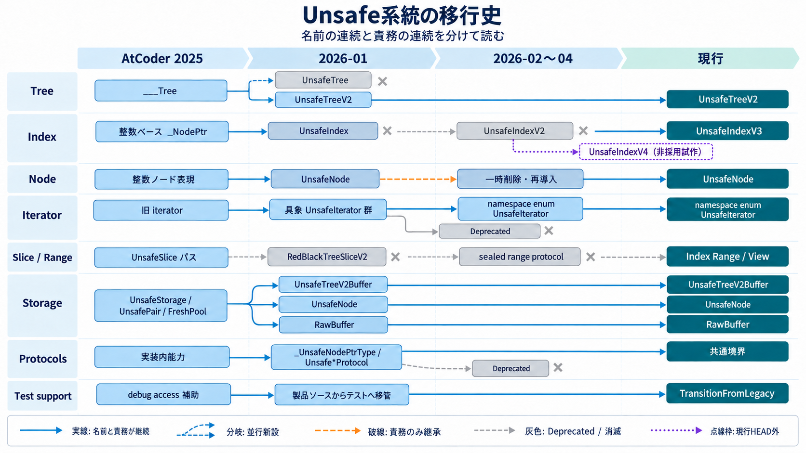

# Refactoring from `release/AtCoder/2025`

## この記録の目的

この文書は、`release/AtCoder/2025`から現行実装への変化が、単調な整理や一括置換では
なかったことを示す。

移行では、稼働していた公開コレクションと検証資産を足場として残しながら、Indexを整数から
ポインタへ変更し、Nodeの同一性、Storageの所有構造、`ManagedBuffer`の役割、Copy on Writeの
成立条件を段階的に組み替えた。並行実装、責務移管、短命な試行、旧経路の撤去を繰り返しており、
開始点と終了点の差分だけでは実施内容を捉えられない。

目的はこの過程を成功談として誇張することではなく、動作する足場を失わずに内部構造を交換した
アクロバット的なリファクタリングの実在を、第三者がGit履歴と保存されたテストから確認できる
形で示すことである。

コミット、旧新パス、中間形、短命な試行、未確定事項は、事実・証拠の正本である
[別紙](REFACTORING_FROM_ATCODER_2025_EVIDENCE.md)に置く。本紙は、その証拠から成立する説明の
正本とする。

## 一枚で見る移行

全体は単純な`UnsafeTree`から`UnsafeTreeV2`へのrenameではない。旧実装を残した並行導入、
Node・Index・Iterator・Storageの責務分解、Deprecatedへの隔離、製品ソースからテスト資料への
移管が異なる時期に進んだ。

そのため、名前の連続と責務の連続は分けて読む必要がある。同じ名前でも実装が差し替わることが
あり、名前が消えても責務が別の型や層へ残ることがある。

## 内部構造の交換

内部構造の中心には、相互に依存する四つの変化がある。

1. **Index:** Node番号を持つ整数Indexから、Nodeを直接指すpointer Indexへ移った。
2. **Node:** 連続領域内の整数リンクから、左右親を実ポインタで結ぶ生メモリNodeへ移った。
3. **Storage:** `ManagedBuffer<Header, Node>`の一体構造から、Headerがraw bucket群を管理する
   `ManagedBufferPointer<Header, Void>`中心の所有構造へ移った。
4. **CoW:** 全Nodeの再配置を伴うcopyから、bucketをin-placeで拡張しつつ、共有時には
   tracking tagから新しいpointer関係を再構築する方式へ移った。

pointer IndexによってNodeへ直接到達できる一方、NodeのアドレスとStorageの寿命が契約へ露出した。
bucket化は一意なStorageの容量追加で既存Nodeを動かさない構造を成立させたが、CoWでは別Storageへ
Nodeを再構築するためpointerが変わる。この差を埋める責務が、`node_id`、tracking tag、
recycle count、sealed pointer、tied storageへ段階的に外在化した。

これは一直線の設計ではない。途中では明示的な参照countやstrong uniquenessも試され、撤去された。
現行方式は、すべてを強く拘束するのではなく、Storageの一意性、Nodeの世代、Indexの寿命を
それぞれの境界で扱う構造へ収束している。

## 動作する足場を残した交換

移行の要石として保存されているテストは次である。

`Tests/RedBlackTreeTests/UnsafeTreeV2/Instance/___RedBlackTreeContainerTests_unsafe.swift`

このテストはAtCoder 2025版の原本そのものではなく、旧コンテナを直接操作するFixtureテストから
移行中に分岐し、新しい内部構造へ追従した派生・再構成版である。固定したNode配置を使い、木の
不変条件、回転、探索、挿入、削除時の`begin`更新を公開APIより下の層で検証した。

現在は`#if false`でコンパイル対象外だが、削除されていない。現行APIへ追従させることより、
旧実装と新実装をつないだ検証方法を一次資料として残すことが優先されている。

Test as Specification自体はこの移行で新しく生まれたものではない。AtCoder 2025版より前から存在した
テストを使い、新実装向けの分岐コピーを作り、移行先の検証手段を成立させてから旧系列を整理した。
つまり、完成像を一度に置き換えるのではなく、実行可能な証拠を先行させ、その証拠を保ったまま
次の内部層へ進んだ。

## 外形も同時に組み替えた

内部構造だけでなく、ソース配置とモジュール境界も段階的に変わった。

- 内部層を`Implements/`へ集約した。
- 本体ディレクトリを`RedBlackTreeModule`から`RedBlackTreeCollections`へ移した。
- package target名とテストの`@testable import`を同じ移行で切り替えた。
- 旧`RedBlackTreeModule`名には、`@_exported import RedBlackTreeCollections`だけを持つ
  互換targetを残した。

このため、現行の「本体は`RedBlackTreeCollections`、旧名は薄い互換layer」という構成も、
一括renameではなく、実装、物理配置、target名、互換入口を分けた移行の結果である。

## この履歴が示す方法

履歴から読み取れる方法は次のとおりである。

1. 稼働中の公開契約とテストを、置換作業の足場として維持する。
2. 新しい内部表現を旧系列と並行して成立させる。
3. Node、pointer操作、allocation、Index寿命、CoWを個別の責務へ分解する。
4. 赤黒木の不変条件を、公開APIの操作結果とは別の検証軸として保つ。
5. 新経路の検証が成立してから、旧経路を削除またはDeprecatedへ隔離する。
6. 移行済みの旧テストを、必要に応じてコンパイル対象外の一次資料として保存する。

この方法は、差分を小さくするという意味で単調だったのではない。複数の内部表現を一時的に
併存させ、検証経路を架け替えながら、最終的には開始時とは異なる所有・同一性モデルへ到達した。

## 拡張から収束へ

AtCoder 2025版からの移行では、内部層、公開4型、View、互換layer、検証手段を広く用意する必要が
あった。現在は新しい構造を増やす段階から、既存の核を外部化された証拠で磨く段階へ移っている。

現在重視しているのは、機能数や自己評価ではなく、次の三点を第三者が再実行可能な形で判断できる
状態である。

1. **正しさ:** C++標準コンテナとの決定論的な挙動比較と回帰テスト
2. **Swiftとしての価値:** CoW、値セマンティクス、Index寿命、Range/Viewを含む仕様テスト
3. **選択理由:** 外部候補との公平な比較と、未計測・不利な結果を含む限界の明示

実行可能な証拠を要石にして次の層へ進む点で、この収束フェーズもAtCoder 2025版から続く
リファクタリング方法の延長上にある。
