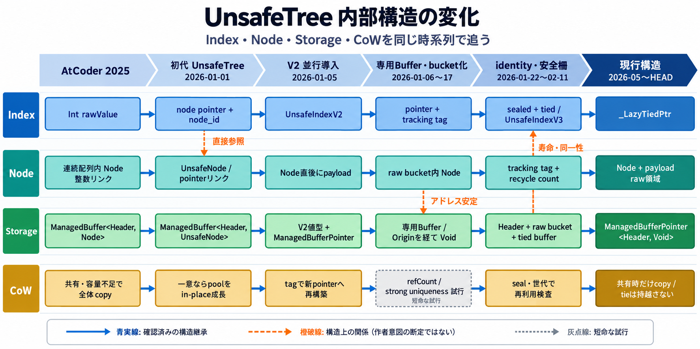

# Refactoring from `release/AtCoder/2025`

> 状態(2026-10-06): 移行史の主要記録は完了。末尾の未追跡事項と、P10で必要になる
> Index統合前の残存記述確認があるため、現時点では継続文書として保持する。

> 調査中(2026-10-11): V3オーサーがUnsafe系統の移行史を担当する。
> `release/AtCoder/2025`から現行`HEAD`までを対象に、名前の連続と実装責務の連続を分けた
> 系統別索引を作成した。現行`HEAD`外の試作は現行系譜へ混ぜず、別の未確認範囲とする。
>
> 追加調査中(2026-10-11): `UnsafeTree`から`UnsafeTreeV2`への内部構造変化を、Index、Node、
> Storage、CoWの四線で追跡する。CoWは構造変化に関係する転換点だけを含め、意味論・安全性・
> 性能の全評価は含めない。証拠関係を一枚の図へ安全に縮約できない場合は画像生成前に中断する。

この文書は、`release/AtCoder/2025`で稼働した赤黒木実装から現在の構成へ移行した際の
手法と段階を、後から追跡できるように記録する。

## 証拠の扱いについて

各記述には次のいずれかの性質を付す。

- **[事実]** `git show` / `git diff` / `git log --follow` 等で直接確認した内容。
- **[証言]** `Maintanance/MAINTENANCE.md` 等にあるユーザー自身の説明。
- **[解釈]** 事実からの推測。リネーム類似度(`-M`のパーセンテージ)は「同一ファイルだと
  判定されたかどうか」という事実としてのみ扱い、そこから契約が変わっていない、または
  作者の意図がこうだった、という結論を直接導かない。

## Unsafe系統の移行表(2026-10-11)

`release/AtCoder/2025`の先端`b2580703`から現行`HEAD`までを対象に、リポジトリが付けた
`Unsafe`型名・protocol名・責務を系統単位で追跡する。標準ライブラリの
`UnsafeMutablePointer`等は、それ自体を一系統として数えない。同じ型に対するextensionや、
同じ責務の分割ファイルは一行へまとめる。

テストクラスやfixtureが製品型と同じ`Unsafe`名を含む場合は、その製品系統の検証資産として扱う。
製品ソースからテストへ移されたdebug access protocolだけは、移管そのものが移行史を示すため
独立行にした。

「名前の連続」は同じ識別子がいつ存在したかを表し、「責務の連続」は異なる名前や一度消えた
名前の間に実装上の継承があるかを表す。両者は同一とは限らない。

| 系統 | 名前が生まれた場所 | 名前が消えた、または役割が変わった場所 | 現行の到達点 | 関係の判定 | 主な証拠 |
|---|---|---|---|---|---|
| `UnsafeTree` → `UnsafeTreeV2` | `UnsafeTree`は`add37b4b`(2026-01-01)で新設。`UnsafeTreeV2`は`7964713d`(2026-01-05)で別型として新設 | `55ccdb3d`(2026-01-05)で旧`UnsafeTree`の大半を削除。ただしV2は当初から旧`UnsafeTree<Base>.Header`と`UnsafeNode`を利用 | `Sources/RedBlackTreeCollections/Implements/UnsafeTreeV2/` | **並行新設後の責務吸収**。単純改名ではない | `git show --summary -M -C add37b4b 7964713d 55ccdb3d`、各時点の型宣言 |
| `UnsafeIndex` → `UnsafeIndexV2` → `UnsafeIndexV3` | 無印は`add37b4b`、V2は`7964713d`、V3は`357335f7`(2026-02-11)でそれぞれ新設 | 無印は`55ccdb3d`で旧`UnsafeTree`群と共に削除。V2の元パスは`a53d9a5b`(2026-01-24)で削除され、`fd6559ac`(2026-02-12)から`Deprecated/Index`に再配置 | `UnsafeIndexV3`は現行で`_LazyTiedPtr`へのtypealias。V2は互換実装として`Deprecated/Index`に残る | **世代交代。ただし同名V3内部でも実装差し替えあり**。型名だけでは実装同一性を示さない | `git log --diff-filter=A/D -- '*UnsafeIndexV*.swift'`、`005a7bb3`(V3のalias先変更) |
| `UnsafeNode` | `add37b4b`で`UnsafeTree/UnsafeNode.swift`として新設 | `1c745eef`でV2側へ移動後、2026-01-18〜19に一度削除を挟み、`364c203d`で`__tree/Unsafe/UnsafeNode.swift`から`__tree/unsafe_tree/UnsafeNode.swift`へ100% rename | `Sources/RedBlackTreeCollections/Implements/__tree/unsafe_node/unsafe_node.swift`の`UnsafeNode` | **名称再出現を含む責務継承候補**。同じ生メモリノード責務は確認できるが、削除前後を単一の連続実装とはまだ断定しない | `git log --name-status -M`、旧版と現行版の`UnsafeNode`宣言・メモリ配置コメント |
| `UnsafeIterator`系 | `add37b4b`で旧Tree用の具象iterator群と補助型を新設。現行のnamespace型`public enum UnsafeIterator`は`5fd598b4`(2026-01-17)で新設 | 旧具象iterator群とV2初期案は`1c745eef`で削除。その後も同名namespace内でObverse/Reverse、tie、remove-aware等を反復改稿し、一部を`Deprecated/Iterator`へ隔離 | `Implements/Iterator/UnsafeIterator/`と`Implements/Deprecated/Iterator/` | **旧具象型群からnamespace型への再構成**。同じ名前でも初期の単一補助型と現行enumは同一実装ではない | `git log --name-status -M -- '*UnsafeIterator*'`、`5fd598b4`の型宣言、`14605f08`(legacy protocol隔離) |
| `UnsafeSlice`パス → `RedBlackTreeSliceV2` → sealed range系 | `add37b4b`で`UnsafeSlice/`、`7964713d`でV2版を新設。ただし宣言型名は`RedBlackTreeSlice_`/`RedBlackTreeSliceV2` | 旧`UnsafeSlice`は`1c745eef`で削除。V2は同コミットで`Slice/`へ移り、`a53d9a5b`でTree外へ移動。2026-02-05に`UnsafeTreeSealedRange`系が導入され、具象rangeは同日中に削除してprotocolへ分解 | 現行ではV2 Slice型はなく、Index rangeとViewが範囲責務を担う。旧sealed range protocol群は`Deprecated/Protocol`に残る | **パス名だけがUnsafeだった系列から、range protocol/Viewへの責務分解** | `git log --name-status -M -- '*UnsafeSlice*' '*RedBlackTreeSliceV2*' '*UnsafeTreeSealedRange*'`、`c9bd428e`、`3c5f1aae` |
| `UnsafeStorage` / `UnsafePair` / `UnsafeNodeFreshPool` → `UnsafeTreeV2Buffer` | `UnsafeStorage`とstorage protocolは`add37b4b`前後、`UnsafePair`は`add37b4b`、FreshPool群は`add37b4b`以降、`UnsafeTreeV2Buffer`は`4a86c72d`(2026-01-06)で導入 | 旧Storageは`55ccdb3d`で削除。Pool V1/V2は`4dad3c9c`(2026-01-17)で削除。`UnsafePair`も2026-01-23までに消滅し、ノード直後のpayload操作とbufferへ責務が分解 | `UnsafeTreeV2Buffer`/`UnsafeTreeV2BufferHeader`、`UnsafeNode`、`RawBuffer` | **一対一の改名ではなく、allocation・header・node/payload責務への分解と統合** | `git log --name-status -M -- '*UnsafeStorage*' '*UnsafePair*' '*UnsafeNodeFreshPool*'`、`4a86c72d`、`4dad3c9c` |
| `_UnsafeNodePtrType`と`Unsafe*Protocol`群 | `_UnsafeNodePtrType`は`aba7c6c0`(2026-01-18)、Index/Tree/Range系protocolは主に2026-02〜04に導入 | Index V2やsealed rangeに密着したprotocolの多くは後に`Deprecated/Protocol`へ隔離。`UnsafeTreeBindingV2`等の共通境界は現役 | `_UnsafeNodePtrType`、`UnsafeTreeBindingV2`等と、Deprecated内の互換protocol | **実装型から能力境界を抽出した後、現役基盤と旧世代契約へ分岐** | `aba7c6c0`、`2b7fea27`、`bf1350f4`、`dff90498`、現行の`Implements/Protocol`と`Deprecated/Protocol` |
| `UnsafeMutableRawPointer+malloc` | `fddc804b`(2026-01-17)でV2 allocation補助として新設 | 型名は変えず、Tree内部→Buffer/RawBuffer→共通`RawBuffer`へ100% renameで移動 | `Implements/RawBuffer/UnsafeMutableRawPointer+malloc.swift` | **責務の共通基盤化**。プロジェクト独自型ではなく標準型へのextension | `e3f1eeb5`、`de3eff3e`、`974d21c4`、`28a1a5fb`、`0ada7b35`の100% rename |
| `UnsafeTreeAccessHandleBase` / `UnsafeTreeNode*AccessProtocol` | `090d7768`〜`9189f2c6`(2026-01-24〜25)に旧debug access補助として新設 | `3b14a466`と`c7a6a8c5`で製品ソースからテストへ移管。その後はLegacy区分を経て`TransitionFromLegacy`へ100% rename | `Tests/RedBlackTreeTests/DebugAdditionals/TransitionFromLegacy/` | **製品実装の後継ではなく、移行観察用テスト補助として保存** | `git log --name-status -M -- '*UnsafeTreeAccessHandleBase*' '*UnsafeTreeNodeAccessProtocol*'` |

**[事実]** `release/AtCoder/2025`時点には、上表の型名としての`UnsafeTree`、`UnsafeIndexV2`、
`UnsafeIndexV3`、`UnsafeNode`は存在しない。一方、`___Tree`、整数ベースの`_NodePtr`、
`__left_unsafe`等のunsafe操作は既に存在する。したがって「Unsafeという名前の誕生」と
「unsafeな責務の誕生」は同じ時点ではない。

**[解釈]** 全系統には、(1)並行実装からの吸収、(2)世代名を変えた交代、(3)名前を保ったままの
分解・再配置、(4)製品ソースからテスト資料への移管が混在する。したがって各行を一律な
`旧名 → 新名`とせず、`rename`、`parallel introduction`、`responsibility transfer`、
`name reuse`、`test-only preservation`、`unrelated`を区別する。

**[事実]** `UnsafeIndexV4`を追加するコミット`77095c38`等は全参照を対象にした`git log --all`では
見つかるが、現行`HEAD`へ至る履歴には含まれない。この表では現行系譜へ直列に接続せず、
**非採用または未統合の試作**として扱う。

**[未確認]** `UnsafeNode`の2026-01-18〜22の削除・再導入区間について、責務の連続は確認できるが、
どの差分を同一実装の継続とみなすかは確定していない。また、現行`HEAD`外のUnsafe系試作を
網羅的に分類する作業は、この表の対象外である。

## `UnsafeTree`内部構造の変化

次の表は、Index、Node、Storage、CoWを同じ時系列で追う。各段階には多数の中間コミットが
存在するが、ここでは後続構造へ残った転換点と、短期間でも設計上の試行を示す転換点に絞る。

| 段階 | Index | Node | Storage / `ManagedBuffer` | CoW | 主な証拠 |
|---|---|---|---|---|---|
| AtCoder 2025 (`b2580703`) | `rawValue: Int`。Index自身が`___Tree`を保持 | `___Tree.Node`を連続要素として格納し、左右親リンクも整数`_NodePtr` | `___Tree`が`ManagedBuffer<Header, Node>`を直接継承。Headerと連続Node領域が一体 | 非一意または容量不足なら、容量を拡張した新しいTreeへ全体copy | `_Tree/___Tree.swift`、`___Tree+Iterator.swift`、`___Tree+CopyOnWrite.swift` |
| 初代`UnsafeTree` (`add37b4b`、2026-01-01) | `rawValue`が`UnsafeMutablePointer<UnsafeNode>?`へ変化。Tree参照とCoW再構築用`___node_id_`も保持 | 左右親リンクが実ポインタになる。Node直後へpayloadを置き、`___node_id_`と初期化状態をNodeへ追加 | `UnsafeTree`は`ManagedBuffer<Header, UnsafeNode>`。Headerのpoolがノード領域を管理 | 共有時はcopyするが、一意で容量だけ不足した場合はpoolを成長できる経路が現れる | `UnsafeTree.swift`、`UnsafeNode.swift`、`UnsafeIndex.swift`、`UnsafeTree+CopyOnWrite.swift` |
| V2の並行導入 (`7964713d`、2026-01-05) | `UnsafeIndexV2`もpointer＋`___node_id_`。V2値がTreeを保持 | 初代`UnsafeNode`を共有 | `UnsafeTreeV2`は値型だが、当初は`ManagedBufferPointer<UnsafeTree.Header, UnsafeNode>`で初代Treeのstorageを包む | V2のcopyは新bufferへNodeとリンクを再構築。初代TreeのHeader・Node責務をまだ借用 | `UnsafeTreeV2.swift`、`UnsafeIndexV2.swift`、`UnsafeTreeV2+CopyOnWrite.swift` |
| 専用Bufferとbucket化 (`4a86c72d`〜`4591b20f`、2026-01-06〜17) | pointer Indexを維持し、Node番号をcopy後の再解決に利用 | Node＋payloadをbucket側へ配置。end、nullptr、recycle/fresh状態を分離 | `UnsafeTreeV2Buffer`を新設。最初は`ManagedBuffer<Header, UnsafeNode>`で要素領域をend専用にし、後に`UnsafeTreeV2Origin`を経て`ManagedBuffer<Header, Void>`へ移行。実Nodeはraw bucket群が所有 | bucket追加は一意なstorageを保ったまま可能。2026-01-12〜13には参照countやpoolまで含むstrong uniquenessを試し、短期間で撤去・単純化 | `4a86c72d`、`f86dbd3b`、`c6cd93a6`、`c55c951c`、`246ec1be`、`4591b20f` |
| identityと安全柵の形成 (2026-01-22〜02-11) | `_TiedRawBuffer`がstorage寿命を受け持ち、V2からV3へ移行。pointerをsealして時間差の無効化を検査 | `___node_id_`は`86ab5952`で`___tracking_tag`へ改名。`___recycle_count`と組み合わせ、Nodeの再利用世代を識別 | Headerがbucket列、begin/root参照、allocator、tied bufferを接続。Nodeの物理アドレスと論理追跡tagを分離 | copy先はtracking tagから新pointerを解決する。`b9b70ada`でsealingを導入し、pointerだけでは検出できない再利用を世代で扱う | `1dc91bf1`、`86ab5952`、`b9b70ada`、`170679d5`、`357335f7` |
| 現行構造 (2026-05〜`HEAD`) | `UnsafeIndexV3 = _LazyTiedPtr`。生pointer、sealed、tiedの三層を用途分離 | `___tracking_tag`、`___recycle_count`、payload有無を保持。payloadはNode直後のraw領域 | `UnsafeTreeV2`は`ManagedBufferPointer<UnsafeTreeV2BufferHeader, Void>`を保持。Headerからraw bucket、`_TiedRawBuffer`、`_LazyTie`へ接続 | `ManagedBufferPointer.isUniqueReference()`を入口に、共有時だけtracking tag順で再構築。copy先へ`_tied`/`_lazyDetach`を持ち越さない | `fa3f3fb0`、`ff5d0bfc`、`005a7bb3`、`09ea07bd`、`Design-CopyOnWrite.md` |

**[事実]** AtCoder 2025版の`_NodePtr`は`Int`であり、Indexの`rawValue`も整数だった。
`add37b4b`ではNodeの左右親リンクとIndexの`rawValue`が実ポインタへ変わり、Nodeへ
`___node_id_`が追加されている。そのコメントは、この番号を論理IndexではなくCoW再構築専用の
一時識別子としている。

**[事実]** `UnsafeTreeV2`の初版は初代`UnsafeTree`のHeaderを利用していた。その後、専用の
`UnsafeTreeV2Buffer`とHeaderを導入し、`ManagedBuffer`のelement領域はNode本体の連続格納から、
endまたはoriginだけを置く段階を経て、現行では`Void`になった。実Nodeとpayloadの所有は
Headerから到達するraw bucket群へ移っている。

**[事実]** CoW方式は一直線には変化していない。2026-01-12〜13には明示的な参照count、
pool deallocatorまで含むstrong uniqueness、単純CoWへの強制と撤去が短期間に続いた。
現行の`_strongEnsureUnique()`は非互換modeでは`ensureUnique()`と同じであり、storage本体の
一意性は`ManagedBufferPointer.isUniqueReference()`で判定する。

**[解釈]** 整数Indexからpointer Indexへの変更により、容量拡張で全Nodeを移動する一体型storageを
そのまま維持しにくくなった。Nodeをbucketへ分離するとアドレスを保った容量追加が可能になる一方、
CoWでは別storageへNodeを再構築するためpointerが変わる。この差を埋める責務が、
`___node_id_`/tracking tag、recycle count、sealed pointer、tied storageへ段階的に外在化したと読める。
ただし、各変更が次の変更を直接の目的として行われたという作者意図までは、コミット差分だけでは
確定しない。

**[解釈]** 画像では、上の六段階を横軸、Index・Node・Storage・CoWを縦の四線として示せる。
短命なCoW試行は個別branchとして全部描かず「参照count／strong uniquenessの試行」とまとめても、
現行構造へ至る主要な関係は失われない。この粒度なら、一枚への縮約は可能と判断する。

## Keystone test

移行の要石として保存しているテストは次のファイルである。

`Tests/RedBlackTreeTests/UnsafeTreeV2/Instance/___RedBlackTreeContainerTests_unsafe.swift`

このファイルは固定したノード配置を直接構築し、木の不変条件、最小・最大ノード、回転、
挿入後の平衡化、探索位置、削除時の`begin`更新を個別に確認する。通常の公開APIテストより
下の層で、コンテナと木アルゴリズムの接続を検証していた。

**[事実]** このファイルは`release/AtCoder/2025`時点の原本そのものではなく、移行中に作った
分岐コピーを新しい内部構造へ追従させた派生・再構成版である。

現在はファイル全体を`#if false`で囲み、コンパイル対象外の保存資料としている。現行APIへ
追従させることより、移行当時の構造、命名、テスト手法を残すことを優先する。

## 前提となる事実: Test as Specificationは移行の産物ではない

**[事実]** コミット`f4e9f69e`(2025-05-25)で、`RedBlackTreeSet`の番号付きTest as
Specification(`RedBlackTreeSet_0_InitializationTests.swift`〜`_9_ProtocolConformanceTests.swift`、
計11ファイル)が既に導入されている。これは`remotes/origin/release/AtCoder/2025`の
先端コミット`b2580703`(2025-09-03、`git merge-base b2580703 HEAD`が`b2580703`自身と一致する
ことで現在の履歴の直線上の祖先と確認済み)より**4か月近く前**であり、
`git ls-tree remotes/origin/release/AtCoder/2025`でも同じ11ファイルが release 時点に既に
存在することを確認した。

なお`b2580703`には同時にタグ`0.1.44`も付与されているが、本書では一貫して
「`release/AtCoder/2025`ブランチの先端コミット」として参照し、タグそのものを移行史の
基準点として扱わない。

**[事実]** keystone testとして保存している
`Tests/RedBlackTreeTests/UnsafeTreeV2/Instance/___RedBlackTreeContainerTests_unsafe.swift`の
直接の前身である`Tests/RedBlackTreeTests/tree/___RedBlackTreeContainerTests.swift`は
`git log --follow`で2024-12-07のコミット`63b5699a`(`moved from tree`)まで遡れ、
AtCoder2025版よりさらに前に遡る。

**[解釈]** 「Test as Specification」や原木テストという手法自体は、AtCoder 2025版からの移行で
新規に持ち込まれたものではなく、それ以前から存在した開発手法が、移行後も一貫して
受け継がれ、他の型へ横展開されたと考えられる。**[事実]** 一方、`RedBlackTreeMultiSet`/
`RedBlackTreeDictionary`/`RedBlackTreeMultiMap`はrelease時点では`_0_`/`_1_`の2ファイルのみ
(`git ls-tree`で確認)で、現在はそれぞれ22〜24ファイルまで分解されている。どの時点の
どのコミットで各ファイルへ分解したかは個別追跡していないため、ここでは「releaseの時点では
未分解だった」という確認済みの差分として記録するに留める。

## ソース本体の移行(時系列)

ソース本体(`Sources/RedBlackTreeModule` → `Sources/RedBlackTreeCollections`)の移行は、
テスト側の移行と時系列が大きく異なるため、節を分けて記録する。

### S1. AtCoder 2025 implementation(〜2025-09-03 `b2580703`)

**[事実]** `remotes/origin/release/AtCoder/2025`では、本体は`Sources/RedBlackTreeModule`直下に
`RedBlackTreeSet.swift`等4型の公開ファイルが直接置かれ、内部実装は`_Tree/`配下へ
`Tree_IndexProtocol`等のprotocol指向設計、`___Tree+CopyOnWrite.swift`のような三連アンダースコア
命名で収められていた(`git ls-tree`で確認)。テストは次の場所にあった。

`Tests/RedBlackTreeTests/tree/___RedBlackTreeContainerTests.swift`

`RedBlackTreeModule`を`@testable import`し、`RedBlackTreeSet`へデバッグ用の操作を直接追加して、
整数ベースのノード表現を組み立てていた。

### S2. 内部層の`Implements/`への集約(`28a1a5fb`、2026-05-04)

**[事実]** コミット`28a1a5fb`(2026-05-04、`file layout`)の直前の親コミットの時点では
`Sources/RedBlackTreeModule`直下に`Implements/`ディレクトリは存在しない。`28a1a5fb`自身が
`git show -M --name-status`上で次の14個の最上位ディレクトリ・ファイルを一括して
`Implements/`配下へ移すリネームである(類似度100%のR行として記録、内容は不変)。

`BoundsExpression` / `Deprecated` / `Index` / `Iterator` / `Memoize` / `Misc` / `Protocol` /
`RangeExpression` / `RawBuffer` / `Test` / `UnsafeTreeV2` / `View` / `__tree` / および
4型の直下`.swift`ファイル群。

**[解釈]** つまり`__tree`・`UnsafeTreeV2`・`BoundsExpression`・`Deprecated`といった概念的な
内部層自体はこのコミットより前から独立ディレクトリとして存在していたが、それらを
`Implements/`という単一の親ディレクトリへ集約する行為そのものは`28a1a5fb`が行った。
「内部層分離が2026-05-04時点で既に存在した」ではなく、「`Implements/`への集約が
2026-05-04に行われた」と記録するのがより正確である。

### S3. モジュール名の変更: `RedBlackTreeModule` → `RedBlackTreeCollections`

**[事実]** 3段階で行われたことを`git show --name-status -M`と`Package.swift`の差分で確認した。

1. `0ada7b35`(2026-05-14、`folder name`): ディレクトリのみ
   `Sources/RedBlackTreeModule` → `Sources/RedBlackTreeCollections`へ100%一致のリネーム
   (240ファイル)。`Package.swift`のターゲット名はまだ`RedBlackTreeModule`のまま、
   `path:`だけが新ディレクトリを指す。
2. `e91c01ff`(2026-06-01 03:17、`RedBlackTreeCollections`): `Package.swift`のターゲット名を
   `RedBlackTreeModule`から`RedBlackTreeCollections`へ変更。同時に、互換用の薄い新ターゲット
   `RedBlackTreeModule`を追加し、中身を`@_exported import RedBlackTreeCollections`のみとした
   (現在の`Sources/_RedBlackTreeModule/RedBlackTreeModule.swift`と同一内容であることを確認)。
   `Tests/RedBlackTreeTests`等の`@testable import`対象もこのコミットで
   `RedBlackTreeCollections`へ切り替わっている。
3. `76328122`(2026-06-01 03:29、同日12分後、`rename`): 新設した互換ターゲットの物理フォルダを
   `Sources/RedBlackTreeModule` → `Sources/_RedBlackTreeModule`へリネーム。これにより現行の
   `Sources/_RedBlackTreeModule/RedBlackTreeModule.swift`が確定した。

**[解釈]** この結果、現行コードベースの「本体は`RedBlackTreeCollections`、`RedBlackTreeModule`は
`@_exported import`のみの互換レイヤー」という構造は、実装を書き直したのではなく、
ターゲット名とディレクトリ名の交換 + 旧名での薄い再公開シムの新設によって成立したと考えられる。

## テスト側の移行

テスト側では、旧実装を直接操作する固定Fixtureテストを捨てず、移行用の分岐コピーとして
利用した。

**[事実]** 2026-01-03の`cc0ca3ad`で、既存の
`Tests/RedBlackTreeTests/tree/___RedBlackTreeContainerTests.swift`を残したまま、unsafe実装向けの
派生ファイルを追加した。分岐直後の両者は、条件コンパイルや内部名に差があるものの、全体構成は
ほぼ同じだった。これにより、旧実装と新しいunsafe実装を並行して検証できる期間を設けている。

**[事実]** その後、移行先のテストは内部構造の変化に合わせて改稿され、現在の
`Tests/RedBlackTreeTests/UnsafeTreeV2/Instance/___RedBlackTreeContainerTests_unsafe.swift`へ至った。
旧系列との対応が分かる名前へ戻し、現在はコンパイル対象外の一次資料として保存している。

**[事実]** 原木(`__tree`)のメモリ配置、ポインタ、比較、mutation、不変条件などのテストは、
最終的に公開コレクションのテストから`RedBlackTreeTreeTests`へ分離された。Fixtureも専用ターゲットへ
分けられ、公開APIの仕様検証と内部ノード契約の検証を別々に実行できる構成になった。

## Test migration(テストの移行について)

ソース本体の移行と同じ重みで記録すべき点として、ユーザーが明言した設計上の判断がある:
**[証言]** 既存のテスト群をゼロから構築し直すのではなく、そのまま活用することをブートストラップの
前提とした(`Maintanance/MAINTENANCE.md`「REFACTORING_FROM_ATCODER_2025 について」の
ユーザー要望に明記)。これは上記の各段階にも一貫して表れている。

- **[事実]** まず分岐コピーを作り、旧系列とkeystone系列を並行して保持した。
  **[解釈]** 新実装側の検証手段を確立してから旧系列を整理したと読め、「作り直すのではなく
  そのまま活用する」という方針と整合する。旧系列を整理した正確な時期は本書では追跡していない。
- **[事実]** keystoneファイル(`___RedBlackTreeContainerTests_unsafe.swift`)は現在も`#if false`で
  コンパイル対象外のまま削除されずに保存されている。
- **[事実]** S3のモジュール名変更では、`Tests/RedBlackTreeTests`等の`@testable import`対象の
  切り替えが実装側のリネームと同一コミット(`e91c01ff`)内で行われており、テストを後回しにせず
  本体と同時に移行している。
- **[事実]** `RedBlackTreeSet`の番号付きTest as Specification(2025-05-25時点で既に11ファイル)に対し、
  `RedBlackTreeMultiSet`/`RedBlackTreeDictionary`/`RedBlackTreeMultiMap`はrelease時点で
  `_0_`/`_1_`の2ファイルのみだった。公開4型のTest as Specificationが足並みを揃えるまでの
  horizontal expansion(各型への横展開)は、本調査ではコミット単位の追跡を行っていない
  (個別のファイル分解コミットは多数に及ぶため、現状のファイル数の差分という確認済みの事実のみを
  記録し、経緯の解釈は含めない)。

## 現行ノード格納方式と結合処理の性能観察(2026-10-03)

**[事実]** 現行実装を対象とした`Maintanance/Archived/CombiningAPIPerformanceEvidence.md`の計測では、
1k〜256k要素の範囲で、既存ツリーへ逐次挿入する`merge`/`insert(contentsOf:)`経路が、
新しい結果ツリーを構築する`formUnion`/`meld`経路より一貫して高速だった。Setのdisjoint入力では
前者が後者のおよそ2倍速く、MultiSetでも同様の傾向を確認した。

**[事実]** Setの`___meld_unique`について、結果バッファの初期容量を`2`から
`count + other.count`へ変える可逆的なPoCを行ったが、変化は対照ケースと同程度の計測ノイズ内
(0.96〜1.04倍)だった。現行のbucket式ノード格納では、容量拡張時に既存ノードを移動せず、
bucketを末尾へ追加する。そのため、この範囲の遅さを単純な再確保不足だけでは説明できない。

**[解釈]** ポインタ・ノード主体の現行格納方式では、逐次挿入側が既存ツリーと既存ノードを
活用できる一方、meld側は結果ツリー全体を新しく構築する。この定数コストの差が、理論計算量では
有利なmeld経路の優位を256k要素まで観測できなかった一因である可能性がある。ただし、
`release/AtCoder/2025`版と同一条件で比較した記録はまだないため、「ポインタ版への移行が性能差を
生んだ」と因果関係を確定することはできない。現時点で確定できるのは、**現行ノード格納方式では、
計測範囲内でmeldの漸近的な利点が実測上現れていない**という点までである。

この仮説を移行史として確定するには、`release/AtCoder/2025`版と現行版で、同じ要素型、入力順、
重複率、storage共有条件、最適化設定を揃えた比較計測が必要になる。

## 拡張から収束へ: 核を磨く段階(2026-10-04〜)

AtCoder 2025版からの移行では、内部層の分離、公開4型への横展開、Test as Specification、
View、互換レイヤー、文書体系など、複数の不足を並行して埋める必要があった。そのため、
それまでの開発は新しい構造や検証手段を広く用意する性質を持っていた。

**[証言]** ユーザーは2026-10-04、雑多な方向へ広げる段階を終え、対象を絞って磨き、
Swift向け順序付きコレクションとしての品質と信憑性を高める段階へ移ったと説明した。
重視するのは機能数や自己評価ではなく、利用者やAIが採用判断を証拠によって正当化できる
状態である。

**[事実]** この方針の下で、次の検証軸が整備または計画されている。

- ルートパッケージの`CppBehaviorReference`/`CppBehaviorReferenceTests`で、同じ操作traceを
  Swift実装とC++標準コンテナへ適用し、戻り値、rank、範囲、各操作後の完全な順序内容を
  比較する。性能測定用の`CppBenchmarks`とは分離している。
- Setの比較を最初の動作見本とし、MultiSet、Dictionary、MultiMapへ同じ責務分離と
  mismatch reportを横展開する方式を採っている。
- MultiSetのC++差分比較は、非空コンテナへの`endIndex` hint挿入でSwift側だけが停止する
  不具合を発見した。最小trace、process-isolatedな修正前失敗、libc++との制御構造差、
  一条件の修正、start/end/空境界、共有経路を使うMultiMapまでを検証へ結び付けた。
- `Maintanance/Archived/AdoptionReadinessAssessment.md`と日本語版(表題「採用判断のための品質証拠」)は、
  順位付けの主張を行わず、有利・不利な証拠へ同じ水準を要求し、検証済みの証拠、限界・
  未計測の軸、採用拡大のゲートを分けている。
- `Maintanance/Archived/SORTED_COLLECTIONS_BENCHMARK_TASK.md`は、Apple
  `swift-collections`のB-treeベース`SortedSet`/`SortedDictionary`を外部比較対象とし、
  同条件の入力・storage状態・計測区間で勝敗と未計測軸を残す計画を定めている。

**[解釈]** これは実装方式を別物へ置き換えるリファクタリングではなく、開発対象と完成条件の
リファクタリングと捉えられる。新しいAPIや型を増やすこと自体を進捗とせず、既にある4型を
次の三つの外部化された証拠で磨く段階である。

1. **正しさ:** C++標準コンテナとの決定論的な挙動比較と最小再現可能な回帰テスト
2. **Swiftとしての価値:** CoW、値セマンティクス、Index寿命、Range/View、multi型を含む
   Test as Specification
3. **選択理由:** B-tree実装を含む外部候補との公平なベンチマークと能力差の明示

この段階では、比較で負ける結果や未検証領域も成果物に含める。目的は「優れているように
見せる」ことではなく、どの用途で選べるか、どの主張がまだできないかを第三者が再実行可能な
形で判断できるようにすることである。

**[解釈]** Test as Specificationを残して内部実装を移した従来の方法と、動作見本を先に作って
4型へ横展開する現在の方法には共通点がある。いずれも完成像を一度に作り直すのではなく、
先行する実行可能な証拠を要石とし、その証拠を保ったまま次の層・次の型へ進む。この意味で、
現在の収束フェーズはAtCoder 2025版から続くリファクタリング手法の延長上にある。

## Refactoring method

**[解釈]** 履歴から確認できる基本方針は次のとおり。

1. 旧コンテナを直接操作する固定Fixtureテストを、削除より先に分岐コピーして残す。
2. ノード表現、ポインタ操作、比較、メモリ配置、allocationを個別の内部層へ分解する。
3. 分解した各層へ専用Fixtureと単体テストを設ける。
4. 赤黒木の不変条件を、操作結果とは別の検証軸として維持する。
5. 公開4型のTest as Specificationと、原木・UnsafeTreeV2の内部契約を分離する。
6. 移行済みの旧テストは、必要に応じてコンパイル対象外の一次資料として温存する。

今後、移行段階を追記するときは、コミット、旧パス、新パス、移した契約、代替テストを
セットで記録する。推測による経緯は確定事実と分けて`[解釈]`として明示する。

## 未確認・今後の課題

- release時点の`RedBlackTreeMultiSet`/`Dictionary`/`MultiMap`がいつ・どのコミットで
  現在のファイル数まで分解されたかは未追跡。
