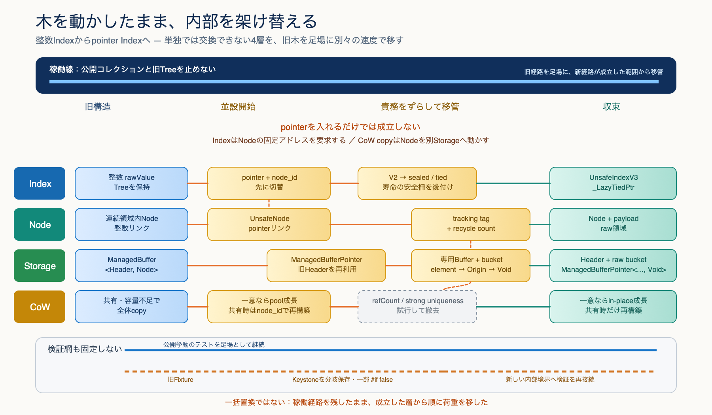

# Refactoring from `release/AtCoder/2025`

## この記録の目的

この文書は、`release/AtCoder/2025`から現行実装への変化が、単調な整理や一括置換では
なかったことを示す。

移行では、稼働していた公開コレクションと検証資産を足場として残しながら、Indexを整数から
ポインタへ変更し、Nodeの同一性、Storageの所有構造、`ManagedBuffer`の役割、Copy on Writeの
成立条件を段階的に組み替えた。並行実装、責務移管、短命な試行、旧経路の撤去を繰り返しており、
開始点と終了点の差分だけでは実施内容を捉えられない。

目的はこの過程を成功談として誇張することではなく、保証範囲を一時的に緩める危険も引き受けながら、
残した足場を使って内部構造と検証手段を架け替えたアクロバット的なリファクタリングの実在を、
第三者がGit履歴と保存されたテストから確認できる形で示すことである。

コミット、旧新パス、中間形、短命な試行、未確定事項は、事実・証拠の正本である
[別紙](EVIDENCE.md)に置く。本紙は、その証拠から成立する説明の
正本とする。

## 架け替えの成立構造

整数Indexだけをpointerへ置換することはできなかった。pointerはNodeの固定アドレスを要求する一方、
従来の連続StorageとCoW copyはNodeを移動する。そこで公開挙動と旧Treeを足場として残し、pointer
IndexとUnsafeNodeを先行して並設した後、Storageを専用Bufferとraw bucketへ移し、Nodeの同一性と
Indexの寿命を後から安全柵へ分離した。検証網も完成形のまま固定せず、公開挙動のテストを残しながら、
内部FixtureとKeystoneを新しい境界へ追従させた。

## 一枚で見る移行

全体は単純な`UnsafeTree`から`UnsafeTreeV2`へのrenameではない。旧実装を残した並行導入、
Node・Index・Iterator・Storageの責務分解、Deprecatedへの隔離、製品ソースからテスト資料への
移管が異なる時期に進んだ。

そのため、名前の連続と責務の連続は分けて読む必要がある。同じ名前でも実装が差し替わることが
あり、名前が消えても責務が別の型や層へ残ることがある。

## 内部構造の交換

内部構造の中心には、相互に依存する四つの変化がある。

1. **Index:** Node番号を持つ整数Indexから、Nodeを直接指すpointer Indexへ移った。
2. **Node:** 連続領域内の整数リンクから、左右親を実ポインタで結ぶ生メモリNodeへ移った。
3. **Storage:** `ManagedBuffer<Header, Node>`の一体構造から、Headerがraw bucket群を管理する
   `ManagedBufferPointer<Header, Void>`中心の所有構造へ移った。
4. **CoW:** 全Nodeの再配置を伴うcopyから、bucketをin-placeで拡張しつつ、共有時には
   tracking tagから新しいpointer関係を再構築する方式へ移った。

pointer IndexによってNodeへ直接到達できる一方、NodeのアドレスとStorageの寿命が契約へ露出した。
bucket化は一意なStorageの容量追加で既存Nodeを動かさない構造を成立させたが、CoWでは別Storageへ
Nodeを再構築するためpointerが変わる。この差を埋める責務が、`node_id`、tracking tag、
recycle count、sealed pointer、tied storageへ段階的に外在化した。

これは一直線の設計ではない。途中では明示的な参照countやstrong uniquenessも試され、撤去された。
現行方式は、すべてを強く拘束するのではなく、Storageの一意性、Nodeの世代、Indexの寿命を
それぞれの境界で扱う構造へ収束している。

## 変化とテストの緊張関係

移行の要石として保存されているテストは次である。

`Tests/RedBlackTreeTests/UnsafeTreeV2/Instance/___RedBlackTreeContainerTests_unsafe.swift`

このテストはAtCoder 2025版の原本そのものではなく、旧コンテナを直接操作するFixtureテストから
移行中に分岐し、新しい内部構造へ追従した派生・再構成版である。固定したNode配置を使い、木の
不変条件、回転、探索、挿入、削除時の`begin`更新を公開APIより下の層で検証した。

このテストは常に実行され続けた守護テストではない。最初のunsafe版は`#if false`で追加され、
新構造へ追従した版は一時期実行対象になったが、Fixtureとテストtargetの再編後、現在は再び
`#if false`でコンパイル対象外になっている。それでも削除されず、「木の開発のブートストラップに
該当する部分」として保存されている。

Test as Specification自体はこの移行で新しく生まれたものではない。AtCoder 2025版より前からある
公開挙動のテストを足場にした一方、内部表現へ強く結合したテストは、構造変更に合わせて条件、期待値、
Fixtureを変更し、一部を無効化・削除・保存した。旧テストをすべて通すことを移行条件にはしなかった。

ここでテストは、変更を一方向に拘束する絶対的な仕様ではない。旧実装の詳細を固定する期待は緩める
必要があり、緩めすぎれば同じ木としての不変条件まで失う。その間でKeystone testは、保証全体を
維持する壁ではなく、木の形、回転、探索、挿入、削除という同一性を次の検証系へ渡す支点として働いた。

したがって、この移行の安全性は「すべてのテストが常にgreenだった」ことにはない。変更が旧テストの
正当性を問い、残したテストが変更の正当性を問い、薄くなった保証を新しいFixture、内部テスト、
番号付きTest as Specificationとして再建した。その縮退と再建を制御したことにある。

## 互換境界の移動

`COMPATIBLE_ATCODER_2025`も、最初から完成した互換layerだったわけではない。2025年10月には
package全体で既定有効な条件として導入され、通常実装の中で型、戻り値、APIの新旧を切り替えた。
新しい内部構造を開発しながらAtCoder 2025時点の外形を動かすため、互換性を製品コードの内側に
抱えた段階である。

内部構造の収束に伴い、旧APIや旧iteratorはDeprecated層と互換条件へ移された。2026年9月末から
10月初めにはdefineの有効・無効を短期間に切り替えながら両構成を調整し、最終的に通常構成を既定へ
戻した。互換性は日常の実装を規定する中心から、必要なときだけ選ぶ境界へ後退した。対応するテストも、
通常版と同じ期待値を共有するのではなく、互換専用のFixture、比較test、skipを含む別の保証面として
整理された。

2026年10月には同じ境界がPermutationにも使われた。ここでは旧APIを現行sourceへ混ぜ直さず、
AtCoder 2025版のsourceを専用directoryへ隔離し、通常版と異なる列挙・CoW・unsafe aliasingを専用の
Test as Specificationで固定した。公開Package traitとして一度試した構成はDocCとの衝突により撤回し、
通常releaseは通常版だけ、互換構成は`prepare/compatible/2`という専用branchで検証する形へ移った。

この変化は、互換性を守るほど通常設計が拘束され、分離するほど旧利用者への再現性が失われるという
別の緊張を示す。解決は互換性の全面維持でも全面削除でもなく、通常製品、条件コンパイル、Deprecated、
専用test、専用branch、単一file生成へ責任を分け、旧挙動が必要な地点まで境界を移動することだった。

## 外形も同時に組み替えた

内部構造だけでなく、ソース配置とモジュール境界も段階的に変わった。

- 内部層を`Implements/`へ集約した。
- 本体ディレクトリを`RedBlackTreeModule`から`RedBlackTreeCollections`へ移した。
- package target名とテストの`@testable import`を同じ移行で切り替えた。
- 旧`RedBlackTreeModule`名には、`@_exported import RedBlackTreeCollections`だけを持つ
  互換targetを残した。

このため、現行の「本体は`RedBlackTreeCollections`、旧名は薄い互換layer」という構成も、
一括renameではなく、実装、物理配置、target名、互換入口を分けた移行の結果である。

## この履歴が示す方法

履歴から読み取れる方法は次のとおりである。

1. 稼働中の公開契約と、次の構造でも意味を持つテストを、置換作業の足場として選別する。
2. 新しい内部表現を旧系列と並行して成立させる。
3. Node、pointer操作、allocation、Index寿命、CoWを個別の責務へ分解する。
4. 旧実装の詳細を固定する保証は緩めつつ、赤黒木の不変条件を独立した検証軸として残す。
5. 新しい内部構造に対応するFixtureと仕様テストを段階的に再建する。
6. 旧契約を通常実装から条件コンパイル、Deprecated、専用branchへ段階的に外在化する。
7. 新経路の検証が成立した範囲から、旧経路を削除またはDeprecatedへ隔離する。
8. 現行suiteへ維持するcostが役割を上回るKeystoneは、コンパイル対象外の一次資料として保存する。

この方法は、差分を小さくするという意味で単調だったのではない。複数の内部表現を一時的に
併存させ、検証経路を架け替えながら、最終的には開始時とは異なる所有・同一性モデルへ到達した。

## 拡張から収束へ

AtCoder 2025版からの移行では、内部層、公開4型、View、互換layer、検証手段を広く用意する必要が
あった。現在は新しい構造を増やす段階から、既存の核を外部化された証拠で磨く段階へ移っている。

現在重視しているのは、機能数や自己評価ではなく、次の三点を第三者が再実行可能な形で判断できる
状態である。

1. **正しさ:** C++標準コンテナとの決定論的な挙動比較と回帰テスト
2. **Swiftとしての価値:** CoW、値セマンティクス、Index寿命、Range/Viewを含む仕様テスト
3. **選択理由:** 外部候補との公平な比較と、未計測・不利な結果を含む限界の明示

実行可能な証拠を要石にして次の層へ進む点で、この収束フェーズもAtCoder 2025版から続く
リファクタリング方法の延長上にある。
